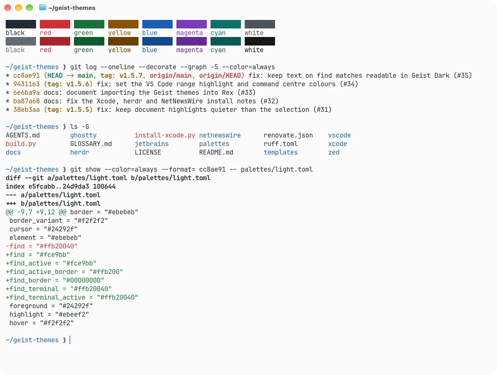
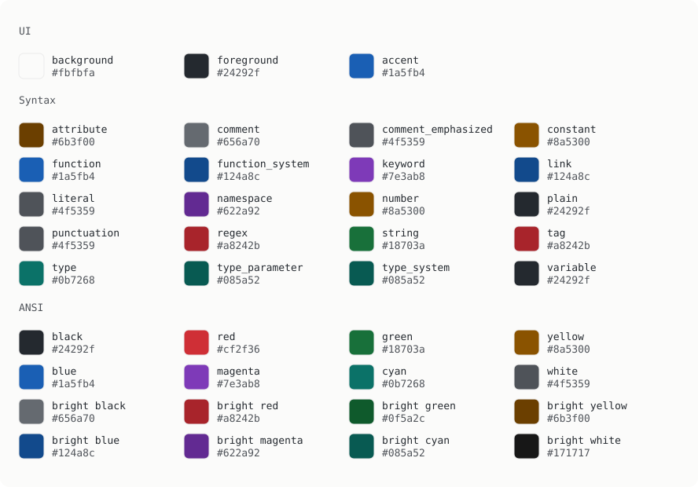
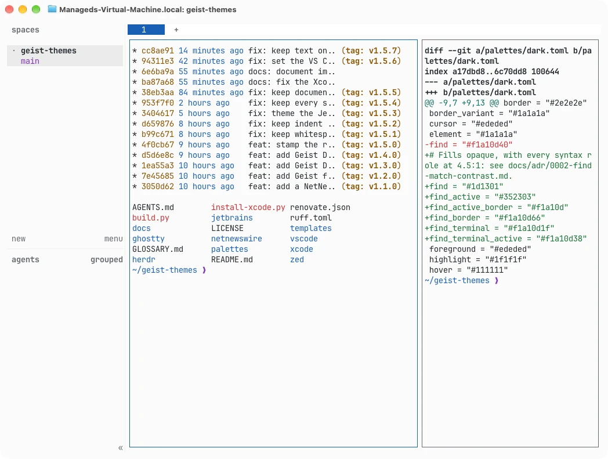
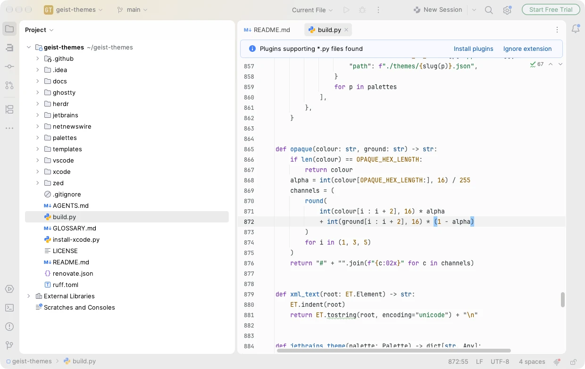
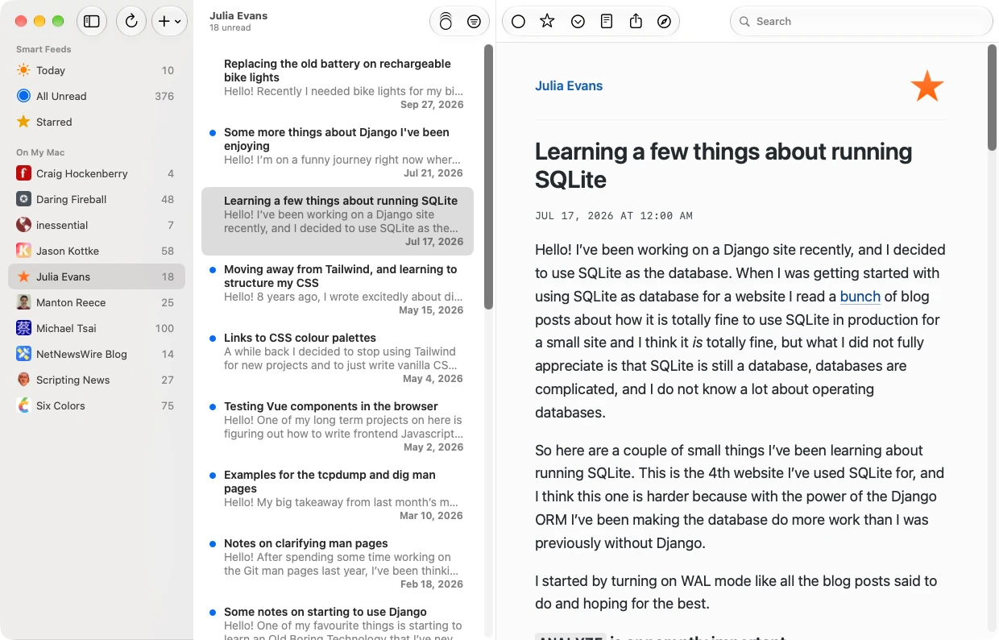
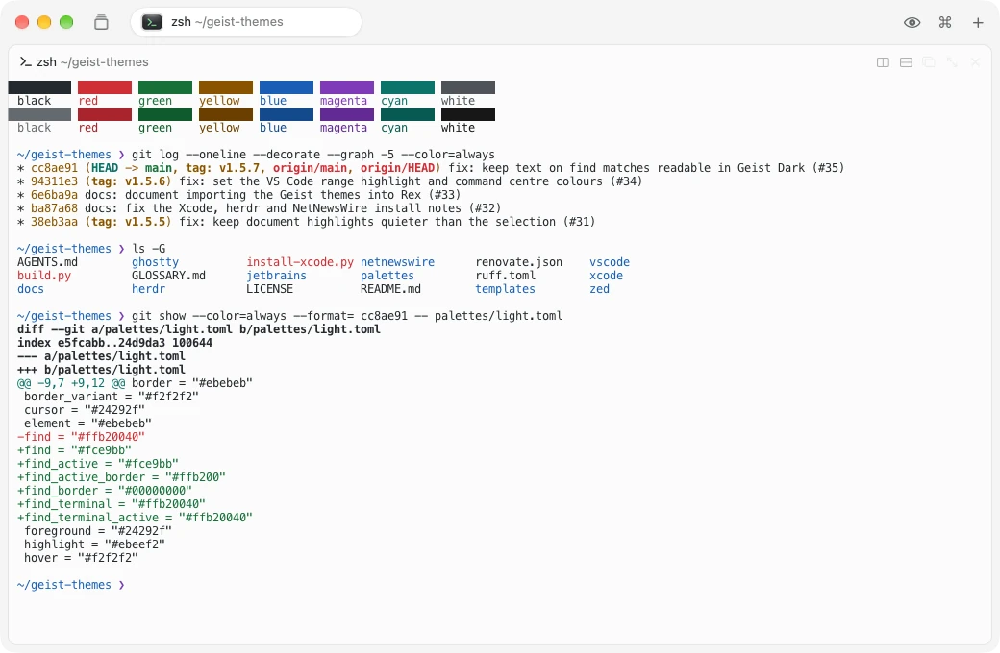
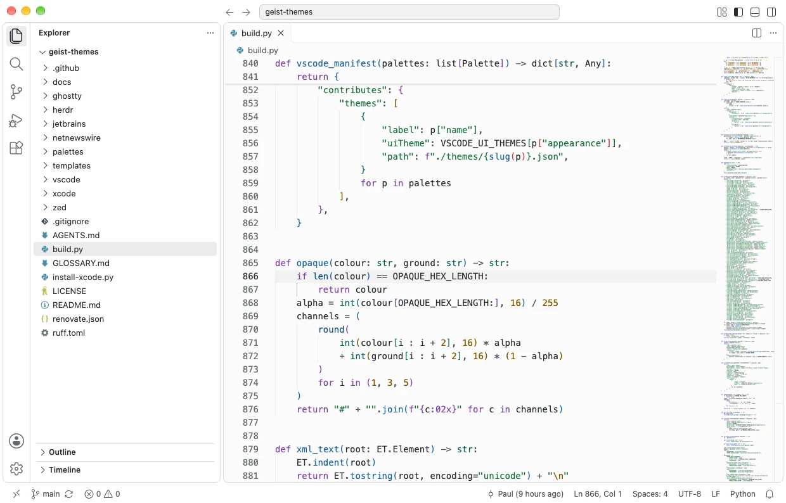
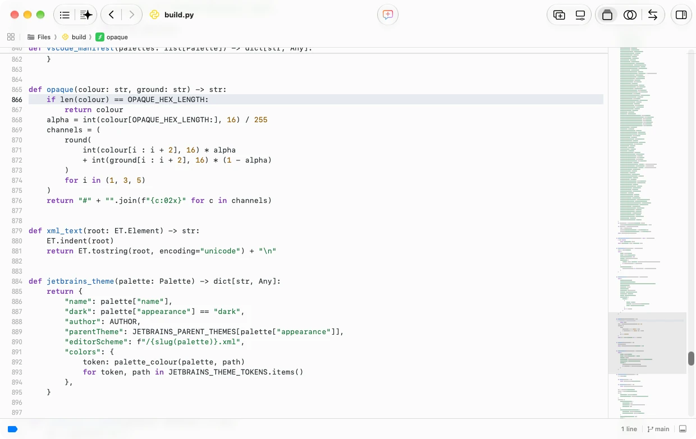
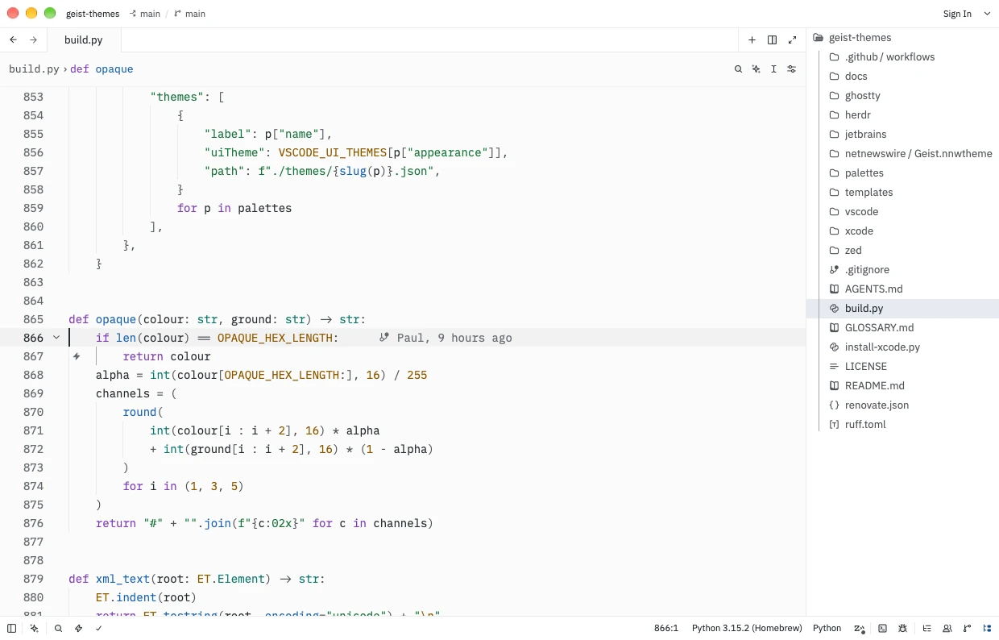

# Geist Themes

Editor and terminal themes built from the colours of Vercel's [Geist terminal themes](https://vercel.com/geist/terminal), for Ghostty, herdr, JetBrains IDEs, NetNewsWire, Rex, VS Code, Xcode 27 and Zed. Each comes in Geist Dark and Geist Light.

This is an unofficial project, not made or endorsed by Vercel. The colours belong to Vercel's Geist design system.

<picture>
  <source media="(prefers-color-scheme: dark)" srcset="docs/screenshots/ghostty-dark.webp">
  
</picture>

## Palette

<picture>
  <source media="(prefers-color-scheme: dark)" srcset="docs/palette-dark.svg">
  
</picture>

## Install

### Ghostty

Copy the Ghostty themes into `~/.config/ghostty/themes/`:

```sh
mkdir -p ~/.config/ghostty/themes
cp "ghostty/Geist Dark" "ghostty/Geist Light" ~/.config/ghostty/themes/
```

Then set `theme = Geist Dark` or `theme = Geist Light` in your Ghostty config. To follow the system appearance, set `theme = light:Geist Light,dark:Geist Dark`.

<picture>
  <source media="(prefers-color-scheme: dark)" srcset="docs/screenshots/ghostty-dark.webp">
  
</picture>

### herdr

herdr can't load a separate theme file, so paste the contents of `herdr/geist.toml` into `~/.config/herdr/config.toml`, replacing the `[theme]` table and every `[theme.custom]`, `[theme.custom.dark]` and `[theme.custom.light]` table already there. Keep any other `[theme]` keys you want, such as `name`, under the pasted `[theme]` header. Then run:

```sh
herdr server reload-config
```

The snippet turns on `auto_switch`, so herdr uses Geist Dark or Geist Light to match the colour scheme your terminal reports. Ghostty reports dark only with a conditional theme, so a fixed `theme = Geist Dark` still reports light and herdr picks Geist Light. In Ghostty, use the conditional `theme = light:Geist Light,dark:Geist Dark` from the [Ghostty](#ghostty) section instead. To keep herdr on Geist Dark instead, pick a theme in herdr's settings, which turns `auto_switch` off and leaves Geist Dark. The snippet sets every colour herdr themes, so it looks the same whichever base theme `theme.name` picks.

<picture>
  <source media="(prefers-color-scheme: dark)" srcset="docs/screenshots/herdr-dark.webp">
  
</picture>

### JetBrains IDEs

For Rider, IntelliJ IDEA, WebStorm and the other JetBrains IDEs, 2026.1 or later. Download the `.jar` from the [latest release](https://github.com/brzzdev/geist-themes/releases/latest), or build it from the repository root, where it reports version `0.0.0-dev`:

```sh
python3 -m zipfile -c geist-themes.jar jetbrains/*
```

Then install the jar with Settings → Plugins → ⚙ → **Install Plugin from Disk…**, and pick **Geist Dark** or **Geist Light** under Appearance & Behavior → Appearance → Theme. Each theme switches the editor to its matching colour scheme.

<picture>
  <source media="(prefers-color-scheme: dark)" srcset="docs/screenshots/jetbrains-dark.webp">
  
</picture>

### NetNewsWire

With NetNewsWire running, open `netnewswire/Geist.nnwtheme` and accept the install prompt. Opening it while NetNewsWire is closed only launches the app, so open it again. Then pick **Geist** in NetNewsWire → Settings → General → Article Theme. The article view follows the system appearance between Geist Dark and Geist Light.

<picture>
  <source media="(prefers-color-scheme: dark)" srcset="docs/screenshots/netnewswire-dark.webp">
  
</picture>

### Rex

Rex imports the Ghostty files. In its Settings → Themes → Import Theme, click **Import** and pick `ghostty/Geist Dark`, then do the same for `ghostty/Geist Light`. Rex files each theme under the appearance it matches and selects it there, so Dark Mode uses **Geist Dark** and Light Mode uses **Geist Light**. To return to them after picking another theme, select them again on the same page.

<picture>
  <source media="(prefers-color-scheme: dark)" srcset="docs/screenshots/rex-dark.webp">
  
</picture>

### VS Code

Package the extension with Node installed:

```sh
cd vscode && npx --yes @vscode/vsce package -o geist-themes.vsix
```

In VS Code (or a fork such as Cursor), run **Extensions: Install from VSIX…** and pick `vscode/geist-themes.vsix`, then choose **Geist Dark** or **Geist Light** with **Preferences: Color Theme**.

<picture>
  <source media="(prefers-color-scheme: dark)" srcset="docs/screenshots/vscode-dark.webp">
  
</picture>

### Xcode 27

Xcode 27 keeps themes in its settings rather than in `.xccolortheme` files. Quit Xcode, then run:

```sh
./install-xcode.py
```

Then, in Xcode → Settings → Appearance → Theme → **Choose…**, pick **Geist Dark** for the dark appearance and **Geist Light** for the light one. Running it again updates the themes in place.

<picture>
  <source media="(prefers-color-scheme: dark)" srcset="docs/screenshots/xcode-dark.webp">
  
</picture>

### Zed

Copy `zed/geist.json` into `~/.config/zed/themes/`, then pick **Geist Dark** or **Geist Light** with `cmd-k cmd-t`.

<picture>
  <source media="(prefers-color-scheme: dark)" srcset="docs/screenshots/zed-dark.webp">
  
</picture>

## Changing colours

Every theme, and each palette card under `docs/`, is generated from `palettes/`. Edit a palette, then regenerate:

```sh
./build.py
```

Commit the palette and the generated files together. CI fails when they disagree.
